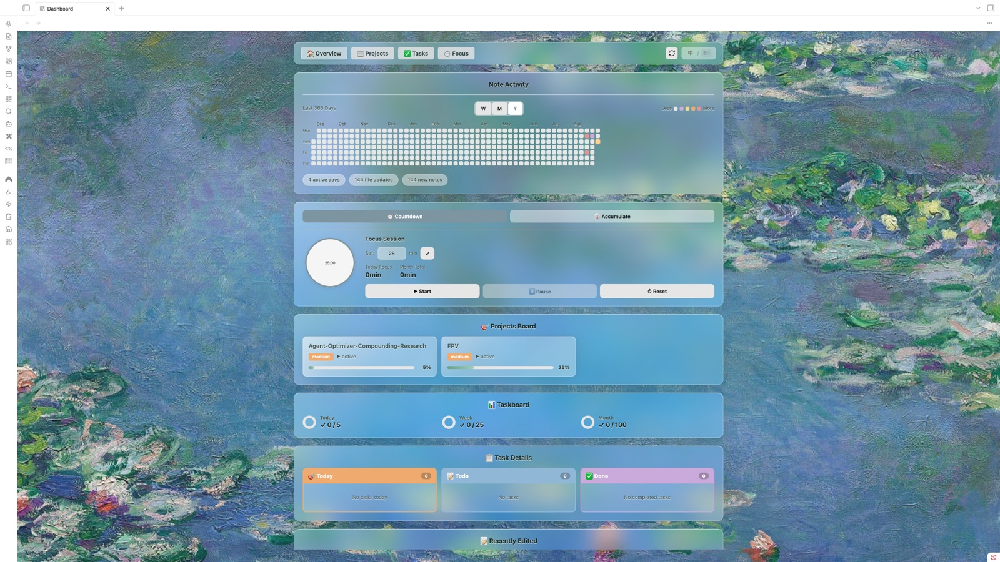

# Elegant Dashboard

An Obsidian dashboard: note-activity heatmap, focus timer, project board, task
management, vault statistics and charts — in one view.

No Dataview dependency, no CDN. All charts are drawn on a canvas, so the plugin
works offline.



*Overview page with the bundled Monet background and liquid-glass panels.*

## Features

### Pages

The dashboard has eight in-plugin pages — nothing opens a markdown tab.

| Page | Contents |
| --- | --- |
| **Overview** | Every module. By default a *home page*: a banner (the bundled Monet, or your own image), avatar and motto, a status line with the everyday actions (refresh, new task, new deadline, start focus), a quick-actions panel and four KPI tiles — tasks done today against the target, the nearest deadline, focus minutes today, habits checked in — and then every module, each as a quiet well inside the same sheet (the Today card is skipped here, since the tiles already say the same). The page switcher sits inside the sheet too, as the first row of the quick-actions panel, so the whole Overview is one sheet. Banner, motto and avatar are set in *Settings → Appearance*. The same setting offers a one-screen *bento*: a fixed 12-column grid that fills the window, four rows of different heights — a short summary strip (clock, Today, task rings, vault numbers); the two working lists, tallest (deadlines beside the three task columns); the day's companions (Next 7 days, habits, projects, focus timer); and a retrospective row (heatmap, charts, recent files) — with each card scrolling internally, so the page itself never scrolls. *Settings → Appearance → Overview layout* switches back to the original stacked rows, described next. Projects and tasks are read-only reports here — edit them on their own pages — but the clock's alarms, the deadline list and the habit strips are fully interactive right on Overview. Compact modules (clock, today, habits, focus, projects, taskboard) share responsive rows instead of each claiming a full-width one; Recent and Stats stack in a narrow column beside Charts rather than sharing a row above it; a heatmap, three columns of tasks or a deadline row with four inline-editable fields still gets the full width. Lists that can grow without bound (deadlines, habits, alarms, recent files, projects) are pinned to a fixed height and scroll internally past that, so a busy list doesn't stretch its card — or the row it shares with its neighbours — taller and taller. |
| **Projects** | All projects including finished ones, fully editable. |
| **Tasks** | All tasks with no per-column cap, fully editable. |
| **Deadlines** | The same deadlines as the Overview card's list, as a month calendar instead: a coloured dot on any day something's due, click a day to see, edit or add what's on it. |
| **Habits** | Every habit with a full scrollable year heatmap instead of the 14-day strip; only today's cell is clickable. |
| **Language** | Vocabulary flashcards. A review session of every word due today (space to flip, 1/2 or ←/→ to answer, a miss comes round again before the session ends), the full word list with search and a per-language filter, and a stats card: words learning vs mastered, the per-box distribution, the most-missed words. Under those, kana and hangul reference charts — hiragana and katakana (gojūon, dakuten, yōon, each cell showing the romaji and its twin in the other script) and the Korean alphabet (consonants, double consonants, vowels, compound vowels) — with a drill: all characters, the weak ones, or a single tapped cell; every answer updates that character's tally and tints its cell green / amber / red. |
| **Focus** | Timer plus the focus-time trend line. |
| **Web links** | Your bookmarks as big icon tiles (marks picked by host, or the emoji a label starts with), added and deleted right there. The same list feeds the optional Sites card on Overview and the home page's *Web links* quick action. |

### Modules

- **Flip clock & alarms** — a flip-card clock (12/24 hour, optional seconds and
  date) over an alarm list: per-alarm time, label, weekday repeat and on/off,
  with a countdown to the next ring. Alarms are checked from a Web Worker,
  because Chromium freezes main-thread timers as soon as the Obsidian window is
  hidden — the exact moment an alarm most needs to fire. A ring shows a notice
  and a stop banner, chimes for up to a minute, and never fires on catch-up more
  than five minutes late.
- **Today overview** — a compact summary that sits beside the clock instead of
  claiming a row of its own: the nearest upcoming deadline, how many deadlines
  are overdue and still unchecked, how many tasks are left today, how many
  habits aren't checked in yet. Built entirely from data
  the other modules already own — nothing new to maintain.
- **Sites** — an optional bookmarks card (off by default): GitHub, Hugging
  Face, mail, a course portal… as buttons, each with a mark picked by host
  (or the emoji your label starts with). Web, `obsidian://` and vault-note
  links all work; the list lives in *Settings → Appearance → Sites*.
- **Custom panels** — an optional module (off by default) for boards of
  your own, entirely data-driven: each panel is a card with a title and a
  list of items, and an item is a web link, a note, a folder (a count tile
  of the notes under it, click to search), a tag (likewise) or an Obsidian
  command. Icons are picked by kind / host unless you give an emoji or a
  Lucide icon name. The classic "Information / Area / GTD / Resource" start
  page is a few of these; nothing about them is baked in. Edited in
  *Settings → Custom panels*. The home page's *Web links* quick action
  jumps to the Web links page.
- **Next 7 days** — an agenda list beside the Today card: for each of the
  coming seven days, the deadlines due, the tasks due and the alarms that
  will ring, in clock order, with a note icon where one is linked. Built from
  the other modules' data, like the Today card; the Deadlines page's calendar
  answers "what's on the 19th?", this answers "what's coming?".
- **Deadlines** — for things with a date, not a recurring schedule (exams,
  submissions). Colour-coded by urgency (today / soon / this week / later /
  overdue). The Overview card is a plain sorted list; the dedicated Deadlines
  page shows the same data as a month calendar instead. Each one can carry an
  optional one-time reminder (same day / 1 / 3 / 7 days before), delivered as
  a quiet Notice from the same background-safe tick the alarms use, and an
  optional time of day (e.g. an exam at 14:00) — shown next to the date and
  on the "today" badge, orders same-day items, and unlocks minute-based
  reminders (15 min / 30 min / 1 h / 2 h before) in the same dropdown. The
  day countdown stays day-granularity either way. Items can be checked off:
  done ones leave the countdown, the Today card and the reminders, and fold
  into a collapsed "Done" section at the foot of the list (dimmed on the
  calendar) rather than being deleted. A deadline can carry *prep tasks*:
  ordinary tasks filed under it (the "preparation for" dropdown in the task
  modal, or typed straight into the fold-out under the deadline row). The row
  shows a 3/5 progress chip that unfolds the list — check them off right
  there — and the agenda shows the same count; the tasks themselves carry a
  ⏳ chip naming their deadline. Deadlines can also come from a calendar:
  *Settings → Calendar import* takes an `.ics` file or a subscription URL
  (synced once a day at startup, or via the *Sync calendar subscription*
  command). Events are matched by UID, so a re-sync updates a moved exam
  instead of duplicating it, and one you deleted stays deleted; a title
  keyword filter (`Prüfung, Klausur, Exam` by default) keeps lectures out.
- **Note activity heatmap** — week / month / year views. Hovering a day shows
  file activity, focus minutes and the notes created that day.
- **Habit tracker** — a per-habit strip of the last 14 days, click any day to
  toggle it (not just today, so a missed check-in can be backfilled). Each
  habit is either daily (streak = consecutive days) or a weekly target like
  "3x a week" (streak = consecutive weeks the target was met, with a
  this-week progress badge) — not every habit is meant to happen every day.
  Besides the global daily reminder in Settings, any habit can have a
  reminder time of its own (a morning habit at 07:30, an evening one at
  22:00); habits with their own time are left out of the global reminder so
  nothing nags twice.
- **Language learning** — a vocabulary deck with Leitner-box spaced
  repetition: a right answer moves a word up one box and its next review out
  to 1 / 3 / 7 / 14 / 30 / 90 days, a miss drops it back to box 0 and due
  today. The Overview card shows today's three numbers — words due, cards
  answered against the daily goal, new words added against theirs — the study
  streak, a button into the review session and a one-line add form (word,
  meaning, language), so a word met in a lecture can be filed without
  leaving the page. A *Look up* button (or Enter in the word box while the
  meaning is empty) fills the meaning and an example from free, key-less
  sources; it works in both directions — type 概率 into a Deutsch deck and
  the word becomes *Wahrscheinlichkeit* with 概率 as the meaning — from — Google Translate's public endpoint (MyMemory as a fallback) for
  the meaning in the UI language, English Wiktionary for a definition and an
  example sentence, and Jisho.org for the kana reading of a Japanese word
  (Korean and other non-Latin scripts get a romanised reading) — as a
  suggestion into empty fields only, never over something typed. Languages and the two daily goals are set in *Settings →
  Language learning*; *Quick add vocabulary word* is also a command. The deck
  is also mirrored into the vault as one generated note per language (a
  table of word, meaning, example, level and date, under *Note/词汇表* by
  default), rewritten whenever the deck changes — searchable and linkable
  like any note, but edited from the dashboard, not in place.
- **Focus timer** — countdown, count-up and pomodoro modes, drawn either as the canvas
  dial or as flip-clock digits with a progress bar. Runs in the plugin, so it
  keeps going when the tab is closed, and banks every whole minute so a crash
  cannot lose a long session. A session can be pointed at a task or a project
  (the *Focus on* dropdown, or the ▶ button on any task row / project card,
  which also starts the timer): its minutes are then attributed there as well
  as to the day. Tasks and projects show their accumulated time as a ⏱ chip,
  and the Focus page adds a *Where it went* breakdown for the selected range,
  deleted targets included, labelled as such. Pomodoro cycles work / short
  break / long break (25 / 5 / 15 minutes, 4 rounds — all in Settings),
  announces each change of phase, rolls straight into the next one unless
  auto-start is off, and has a Skip button; break minutes are never counted
  as focus.
- **Projects board** — click the progress bar to set progress, click the status
  chip to cycle it, pencil to edit. Drag cards to arrange the board; finished
  projects still sink to the bottom. (Earlier versions sorted by priority;
  now the order is yours.)
- **Taskboard** — completion rings against daily / weekly / monthly targets.
- **Task details** — today / todo / done columns with checkboxes, inline add and
  (on the Tasks page) a filter bar — text search over name, notes and tags, a
  section dropdown, high-priority and has-due-date toggles — and
  an edit modal (text, priority, pin, due date, repeat, linked note, free-text
  notes — a ≡ button on the row unfolds them in place). Drag rows within the
  Today / To-do columns to reorder; pinned and high-priority tasks still come
  first, drag order decides within those. Sections are managed in *Settings → Task
  sections*: rename (tasks follow), reorder, delete (tasks fall back to the
  first section), add. A
  repeating task (daily / weekly on chosen weekdays / monthly) comes back when
  checked off: the finished copy stays in Done and counts towards the targets,
  and a fresh one is scheduled for the next occurrence after both its due
  date and today — so a daily task finished three days late comes back
  tomorrow, not three times over. Finished tasks don't pile up: after a day
  (configurable) they leave the Done column for a collapsed "finished
  earlier" fold on the Tasks page — still counted towards the daily / weekly
  / monthly targets — and after 35 days (configurable, or never) they are
  deleted outright, by which point the daily snapshots have long had them.
- **Recently edited** — ambiguous basenames are qualified with their folder.
- **Vault stats** — notes, words and links. The word counter is CJK-aware:
  Chinese characters are counted individually rather than as one "word" per
  paragraph.
- **Charts** — 12-month word trend and tag distribution, both with hover
  tooltips and highlight.
- **Focus history** — line chart with week / month / year ranges, plus totals,
  daily average, best day and current streak.

### Appearance

- **Liquid glass** — backdrop blur with saturation boost, specular edge
  highlights and a diagonal sheen. Toggleable, with an adjustable blur radius.
- **Background image** — a URL or a vault-relative path. Local paths are
  resolved to `app://` resource URLs so they work offline.
- Separate opacity sliders for the background and the card tint.
- English and Chinese, switchable from the navbar.

### Linked notes

Any task, project or deadline can point at a note in the vault — the course
notes an exam is about, a project's own page. The edit modals (tasks,
projects) have a *Linked note* field with path suggestions; deadline rows get
a paperclip button that opens the same picker. A linked item shows a
note icon that opens the note in a new tab, leaving the dashboard where it
is; if the note has since been moved or deleted the icon turns red so the
link can be fixed rather than silently lost. Links are stored as plain vault
paths in `data.json`, not as wikilinks; the plugin listens for renames and
moves (of notes and of the folders above them) and updates the paths itself.

## Data storage

Tasks, projects, deadlines, habits and alarms all live in the plugin's
`data.json`, not in markdown notes. Every record carries a UUID, so edits and
deletions are located by id rather than by line number.

Two safety nets, since none of that has version history the way a note does:

- **Undo** — every delete (task, project, deadline, habit, alarm) shows a
  Notice with an Undo button for a few seconds before it's gone for good.
- **Automatic snapshots** — on by default: once a day (first save of the
  day, or startup) a copy of the data goes to
  `.obsidian/elegant-dashboard-backups/data-YYYY-MM-DD.json`, keeping the
  last 7 (configurable, 1–30). *Settings → Data storage → Restore from
  snapshot* lists them; restoring first saves the current state as a
  "before restore" snapshot, so even a wrong restore is undoable. The folder
  lives beside the plugin, not inside it, so uninstalling or re-cloning the
  plugin leaves it alone.
- **Backup** — *Settings → Data storage* has Export / Import buttons.
  Export downloads the current data as a JSON file; Import replaces
  everything with a previously exported file. Both go through the plugin's
  own settings shape, so an older backup missing a newer field (added in a
  later release) still imports cleanly — the gap is filled with defaults
  rather than rejected.

This is a deliberate trade-off:

- **Upside** — no note clutter, no stale line numbers, no risk of clobbering a
  concurrent editor edit.
- **Downside** — tasks are not visible to the Tasks plugin, Dataview, or global
  search, and uninstalling the plugin leaves the data as JSON.

Because the data lives under `.obsidian/`, make sure your sync or backup covers
`.obsidian/plugins/elegant-dashboard/data.json`.

## Install

The repository ships the built plugin, so no build step is required.

### Clone straight into your vault (easiest)

```bash
cd /path/to/your-vault/.obsidian/plugins
git clone https://github.com/yuze-ji/elegant-dashboard.git
```

Then enable **Elegant Dashboard** in *Settings → Community plugins*. If it is
not listed, click the reload icon next to *Installed plugins* first.

### Download the ZIP

1. **Code → Download ZIP** on the repository page.
2. Unzip it into `<vault>/.obsidian/plugins/`.
3. **Rename the folder** from `elegant-dashboard-main` to `elegant-dashboard`.
   GitHub appends the branch name, and Obsidian ignores folders whose name does
   not match the plugin id.
4. Enable it in *Settings → Community plugins*.

### Minimum files

If you prefer to copy files by hand, these three are enough — the same three
the Community Plugins installer fetches from a release, so the bundled
background works either way (it's a data URI baked into `styles.css`, not a
separate file):

| File | Purpose |
| --- | --- |
| `main.js` | The plugin itself |
| `manifest.json` | Plugin metadata |
| `styles.css` | Styling, including the bundled background image |

Everything else in the repository is source and build tooling.

### From source

```bash
npm install
npm run build   # or `npm run dev` for a watch build
```

Requires Obsidian 1.6 or newer.

## Usage

Open the dashboard from the ribbon icon or the command palette. *Settings →
General → Open on startup* opens it automatically once Obsidian has restored
the previous session's layout — off by default, since a plugin silently
taking over the workspace on every launch should be opt-in.

| Command | What it does |
| --- | --- |
| `Open dashboard` | Reveals the dashboard tab, or creates one. |
| `Refresh dashboard` | Clears the word-count cache and redraws. |
| `Start / pause focus timer` | Controls the timer without opening the view. |
| `Quick add task` | Opens the task modal from anywhere — the note you're editing is pre-filled as the linked note. Bind it to a hotkey. |
| `Quick add deadline` | Same for deadlines: title, date (today by default), optional time, linked note. |

## Background image

Monet's *Water Lilies* (1906, Ryerson) ships with the plugin, baked into
`styles.css` as a resized, recompressed data URI, and is enabled by default so
a fresh install looks like the screenshots. Embedding it — rather than
shipping a loose `background.jpg` — is what lets it survive the official
Community Plugins install path, which only ever pulls `main.js`,
`manifest.json` and `styles.css` from a release. The painting is in the public
domain; the original comes from
[Wikimedia Commons](https://commons.wikimedia.org/wiki/File:Claude_Monet_-_Water_Lilies_-_1906,_Ryerson.jpg).

In *Settings → Appearance* you can:

- point **Background image** at any URL or vault-relative path,
- press **Monet** to return to the bundled painting,
- press **Gradient** for a soft green-blue-lavender wash with no image (the
  sentinel `@gradient`),
- soften any image with **Background blur** (0–40 px),
- press **Clear** to turn the background off,
- adjust background opacity, background blur and card tint independently.

The bundled image is referenced by the sentinel `@bundled`, which resolves to
the embedded data URI regardless of where the plugin is installed.

## License

MIT — see [LICENSE](LICENSE).
